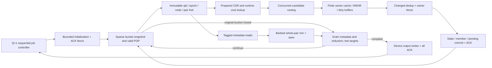

# SPARSE_STREAM_R2 — in progress

Independent implementation from `5651a34abb97939bee6402c5af585753ab07f64b`.
Main contract: `RESIDENT_COMPLETE_BATCH_V2`; never substitute assumed clock or
memory parameters for measured hardware or qualified full-kernel OOC results.

`reference_pop_reduce.cpp` implements valid-POP whole-pair output reduction and
retains a separately stored closed-fold oracle strictly for functional checking.
It is not a CPU performance benchmark. `config/experiment_spec.r2.yaml` records
capacities and explicit memory assumptions; the supplied guide/package is copied
under `config/guidance_package` with its original hash manifest.

The actual 8-lane hardware has one batch start, runtime cost preload with leaf
acknowledgements, tagged POP metadata, eight cell RAM banks, registered minimum
selection/control, bounded initialization and output-write contexts, and a
finite shared physical-memory fabric. Mutable initialization, all device traffic,
commands, conflicts, commit and write acknowledgements are timed. No host loop
performs free sample initialization or intermediate output extraction.

The current implementation is `rtl/many_tile.sv`: 8 or 32 lanes, five finite
clients per owner through a tagged local uplink to shared physical ports,
external node-state backing, and a 64-job sequential controller. The completed
large-model candidate is 32 lanes/32 ports, 8192 member and changed slots per
owner. A second candidate retains those 32 owners and capacities but shares
eight physical ports. Its independent RTL/model calibration has passed; its
native full batches and routed implementation are still running. Neither
complete 32-lane candidate has a qualified clock yet.
A complete 64-lane implementation is **not** provided or qualified.

The functional flow is shown below. These arrows describe dependencies, not
free transfers or measured rates. Every external-memory client shares the same
finite physical fabric; its port count, IDs, arbitration and service gap are
explicit model assumptions.



The candidate and cell routers accept multiple inputs concurrently. The
`parallel_router_ready_a` unit regression checks four 8/32-input configurations
against the frozen previous RTL and an independent finite-queue scoreboard.
The direct one-hot ready reduction preserves cycles; any frequency benefit
requires the corresponding complete physical implementation and fresh binding.

Reproduce the current 32-lane RTL and independent cycle model with new names:

```sh
python3 accel/lookahead/fpga_sparse_stream_r2/sim/build_many.py replay32 32 32 -GMEMBER_CAP=8192 -GCHANGED_LIMIT=8192 -GUSE_URAM=1 -GREQUEST_STAGE=1
python3 accel/lookahead/fpga_sparse_stream_r2/sim/run_many.py replay32 60 native
python3 accel/lookahead/fpga_sparse_stream_r2/sim/run_many.py replay32 60 fixtures
python3 accel/lookahead/fpga_sparse_stream_r2/sim/run_many.py replay32 120 stress,stress_random
python3 accel/lookahead/fpga_sparse_stream_r2/sim/run_many.py replay32 60 external_nodes_65536,external_nodes_4194304
python3 accel/lookahead/fpga_sparse_stream_r2/sim/build_many_model.py replay32_model 32 32 8192 8192 1 1 1 1 1 1
python3 accel/lookahead/fpga_sparse_stream_r2/sim/calibrate_many_suites.py replay32_model replay32
python3 accel/lookahead/fpga_sparse_stream_r2/sim/sweep_fixed_time.py replay32 replay32_model
python3 accel/lookahead/fpga_sparse_stream_r2/tests/batch_capacity.py replay32
python3 accel/lookahead/fpga_sparse_stream_r2/tests/many_hot_capacity.py replay32 replay32_model
python3 accel/lookahead/fpga_sparse_stream_r2/sim/calibrate_many_boundaries.py replay32_model replay32
python3 accel/lookahead/fpga_sparse_stream_r2/sim/run_large_model.py replay32_model 60 2
```

The model's six final flags are cache enable, registered ready, single
combinational evaluation, idle-service memoization, request output stage, and
host packed-bit optimization. Host implementation optimizations do not skip
hardware clocks. Source hashes, compiler flags and exact executable identities
are recorded. Calibration requires all 97 completed RTL references and compares
all cycle rows, all output bytes and every summary counter. A complete native
batch runs all 40 samples after one DUT start; progress is never a final result.

For 8-lane service validation use `L=8`, `P=8`, `MEMBER_CAP=1024`,
`CHANGED_LIMIT=512`, `USE_URAM=0`; corresponding model capacities must match.
For F0 add `-GCACHE_ENABLE=0` and set the model cache flag to zero. F0 retains
32 independent line transactions, 16 writes, finite FIFOs and write-ACK hazards;
it is separately calibrated against F0 RTL. It does not inherit F1 timing.

To reproduce the 32-owner/eight-port candidate, use new names and set both
models to eight ports. The validation driver builds RTL, runs all 97 references,
the 36 fixed-time cases and the four capacity/batch comparisons. The subsequent
18 cases add the explicitly hypothetical 10 ns kernel period; none of these
periods is assigned by simulation as an operating frequency.

```sh
python3 accel/lookahead/fpga_sparse_stream_r2/sim/build_many_model.py replay32p8_model 32 8 8192 8192 1 1 1 1 1 1
python3 accel/lookahead/fpga_sparse_stream_r2/sim/validate_many_candidate.py replay32p8 replay32p8_model router_ready_calibration --lanes 32 --ports 8
python3 accel/lookahead/fpga_sparse_stream_r2/sim/sweep_fixed_time.py replay32p8 replay32p8_model --period-ps 10000 --tag fixed_time_10ns
python3 accel/lookahead/fpga_sparse_stream_r2/sim/run_large_model.py replay32p8_model 60 2
```

Run each dependent command only after its predecessor succeeds. The last
command executes complete BNN and LSTM 40-sample batches; it does not reuse
P32 traffic or intermediate scheduling. For the physical wrapper,
`gen_ooc_context.py many 32 8 8192 8192 1 1 1` generates
`r2_many32_p8_context`. Its frozen RTL, parameters and reports must be bound to
this candidate before assigning any clock. The independent
`central_onehot_a` unit's 80 MHz qualification does not apply: this complete
candidate retains the default fabric payload selector.

Selected unit checks:

```sh
python3 accel/lookahead/fpga_sparse_stream_r2/sim/test_cache_way.py way_replay
python3 accel/lookahead/fpga_sparse_stream_r2/sim/test_owner_pipeline.py owner_replay -GREQUEST_STAGE=1
python3 accel/lookahead/fpga_sparse_stream_r2/sim/test_node_state.py state_replay -GREQUEST_STAGE=1 -GOWNER_BITS=5
python3 accel/lookahead/fpga_sparse_stream_r2/sim/test_pop_epoch.py epoch_replay
python3 accel/lookahead/fpga_sparse_stream_r2/sim/test_pop_metadata.py metadata_replay
```

The state test checks the whole finite 64MiB backing across 4M node addresses,
including command stability, dirty RAW, output backpressure and final fence.
The way test exhaustively checks 81920 state combinations against the old policy.
Owner warm II1 is a service-unit measurement, distinct from complete-batch
average throughput. Independent models retain the original selection algorithms
so the new balanced RTL is checked against a separately written reference.

Current RTL is maintained directly. Historical bootstrap generators such as
`gen_node_state.py` are not the authority for the later reviewed source; do not
regenerate current RTL from them. Earlier `pipe_full*`, `external_*` and their
negative results remain separate experiments with frozen source directories.
Every new run needs a new name; no previous experiment is overwritten.

For Vivado 2022.2, `gen_ooc_context.py` and `prepare_context_ooc.py` freeze an
actual same-clock launch/capture context with a BUFG, source hashes, XDC and
report hooks. Execute its `setup.tcl`, synthesis and implementation through the
existing headless Vivado MCP session. `prepare_routed_sta.py` emits a follow-up
Tcl script that waits for the already launched route and tests explicitly listed
periods on the same routed netlist. Its output remains pending review: require
setup **and** hold, complete constraints, route status and methodology checks.
It adds no false path and removes no IO delay. Unit clock qualification never
qualifies the full kernel, and no context is a board shell.

`check_routed_sta.py` mechanically checks a saved period, including setup, hold, pulse width, zero unconstrained endpoints, complete routing and retained IO constraints. Unknown methodology/DRC rules require review. `audit_complete_work.py` checks completed native output, candidate/commit work against M1, every wave's unique commit count, service peaks, cost/job/output traffic and real mutable initialization. Its positive d3/d4 checks and four rejected mutations are retained. Neither tool assigns a full-kernel clock from a unit result.

`compare_port_count.py NEW.json P32_BINDING.json P8_BINDING.json` compares only
matched, fully audited native40 F1 runs, with exact active sources, inputs and
work sets. It reports cycles and per-array traffic without assigning a clock.
The unchanged limit of 64 IDs per port means total physical credits also change
with port count.
`prepare_failed_route_diagnosis.py VARIANT NEW_TAG RUN_NAME` can inspect a
completed alternate implementation run from a copied error checkpoint; it
preserves the original run and cannot qualify a clock.

`inspect_live_runs.py` provides a read-only recovery view with process identity,
progress, OOC handles and calibration records. `freeze_checkpoint.py NAME PREV
--defer-running-batches` preserves completed evidence and active batch receipts;
full active traces stay on the shared filesystem until completion. Add
`--defer-running-rtl` to keep growing RTL pipeline traces there as well while
freezing their JSON status and immutable source/build bindings. The manifest
lists every deferred variant; its final traces require a later snapshot.
`verify_snapshot.py NAME` checks all archived bytes including predecessors.

The granular checkpoint and raw logs are in
`results/fpga_sparse_stream_r2_20261112`; compact immutable checkpoints are under
its `evidence_snapshot`. See `docs/lookahead_fpga_sparse_stream_r2.md` for current
scope and unresolved work. No FPGA speedup claim or board measurement is made.


Archived evidence can be restored into a **new** destination with
`python3 accel/lookahead/fpga_sparse_stream_r2/sim/restore_snapshot.py /tmp/r2_evidence_restored checkpoint_20261113T1212 completed_address8_route_0231 completed_checked8_route_0245`.
The main checkpoint recursively restores its predecessors; explicitly named
OOC archives add their timing reports. Use the desired completed-stage archive
from `evidence_snapshot` for other physical candidates. Every part, original
file size and SHA256 is verified. Only this invocation may overwrite its own
restored files; an existing destination is rejected. The actual two-archive
restore test is recorded in `supervision/restoration_test_0055.json`; it is
separate from verification of the entire checkpoint chain. Large native input
workloads, generated executables and Vivado DCPs remain on the shared filesystem
at the bound paths; the compact Git evidence includes their recorded identities
and source/build commands, not those external artifacts themselves.

`analyze_cache_ablation.py` compares complete audited F0/F1 native batches only
when hardware parameters (except proposal cache), full input/output identities,
work counts and the memory service contract agree. It publishes cycle and
traffic ratios, never an unqualified full-kernel frequency or FPGA/GPU speedup.

`analyze_memory_sensitivity.py OUTPUT.json MODEL RUN [RUN ...]` compares two or
more completed, independently audited runs of one executable. The first run is
the reference. It rehashes actual workload/prepared/golden/output files, checks
identical finite topology, seed and per-wave commit sets, and reports cycles,
traffic by array, capacity peaks and phase counters. Latency and service gap
remain explicit cycle-domain assumptions; seconds stay null. Use a new output
name after additional complete audits become available.

For a separate physical strategy run using the same synthesis, pass its exact
name to `prepare_routed_sta.py` as `--run=impl_spread_a` and use a new
`--tag=routed_sta_spread_a`. The original implementation is never reset.
`bind_complete_candidate.py --sta-tag routed_sta_spread_a` accepts only that
reviewed report set; a missing or failed qualification leaves seconds null.
`prepare_failed_route_diagnosis.py` copies only an exited failed run with a
completed error-checkpoint marker and rechecks both SHA256 identities before
emitting read-only reports. The default-route failure and its physical-strategy
follow-up remain different results even when their RTL is identical.


`run_large_model.py` rehashes workload, golden and prepared CSR against the
existing native/preparation manifests before launching each new full batch.
Its new receipts record the prepared hash, preparation receipt hash and runner
hash. This changes provenance only, not model cycles or input data. Earlier
receipts remain unchanged; the separately dated current-input audit is not
presented as a historical startup measurement.
