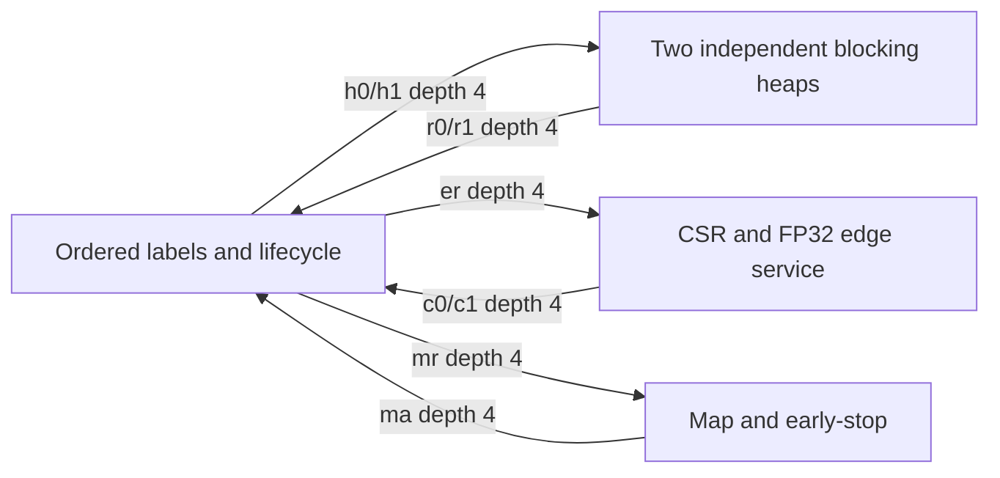

# R5.1 independent services and bounded neighbor overlap

Base: `52b5622687867756e9109b94c99685712ad0e21f`; branch
`accel/lookahead-round5_1-20261109`. Main and historical evidence are unchanged.
Results root: `results/lookahead_accel_round5_1_20261109T072948Z`.

This round separates a **small mechanism prototype** from a **native-batch
performance candidate**. The prototype has 32 nodes, 128 edges, 8 real job slots,
8 cells/job and two resident contexts. It is not the complete 3×3 batch and its
cycles must not be compared to native CPU time. Original CSR order, FP32 rounding,
right-child ties, strict `visited < candidate`, early-stop and SINK rules remain.
No relaxed semantic mode was added to STRICT. No jobs were replicated to create
performance supply. There is no new implemented frequency or board measurement.

## Frozen diagnostic

The replayed package audit agrees with its supplied JSON. R5 ctx2/ctx4 visits
are 42,417/52,822; DEAD 524/10,927; ASSIGN 9/11; all other counts agree. Both RTL
E1 counts minus three times visits are 1,217. Thus the entire 31,215-cycle
regression is `(10,403 + 2) * 3`. Same-qid revisit gaps 6/12 explain feedback
143.403/286.806 POP and 26.601/53.203 PUSH. These are dispatcher feedback,
not independent heap latency. Removing every DEAD leaves 126,896/126,902 cycles;
ctx2 gains at most 1.01239×. Even II1 has 41,893 useful visits, including 5,232
label resets, above the reference 200 MHz CPU budget of 5,184 cycles.

## State ownership and physical network

`services51.hpp::network` uses classic 2022.2 DATAFLOW, with two heap processes,
one edge process, one commit/lifecycle process, and one map process. Each has
its own control and can wait independently. The commit switch interprets only
its owned label/lifecycle states; it does not issue heap or edge micro-operations.
There is no copy of R5 DISPATCH around the network. No `DEPENDENCE false` is used.

| State / storage | Unique search owner | Ports / finite capacity |
|---|---|---|
| 96-bit physical heap and physical count | heap0 or heap1 | even/odd T2P BRAM, one-cycle read; 129 logical entries/context |
| Logical size, pending count, visited, expanded, ordered edge position | commit | per-context 32×32-bit visited and 32-bit expanded arrays, T2P; no speculative label writes |
| CSR cursor, candidate arithmetic | edge | row 33×32, edge 128×32, cost 64×64, node 32×128; each RAM 2 ports, one-cycle read |
| Output, target coverage | map | 8×8×64-bit output, 8×32×32-bit cells, 2 remaining counters; serialized RMW |
| Read-only node metadata for map | map | explicit second 32×128-bit image, loaded with the edge copy |
| Context assignment, reset requests, generation, completion | commit | two contexts; actual job count ≤8; reset writes use the label owner's port |
| Requests/responses | indicated single producer/consumer | 9 depth-4 FIFOs; Message/Candidate 289 bits, MapReply 161 bits |

Each message carries generation, qid, context, parent sequence, CSR ordinal and
payload or control validity. FIFO capacity is separate from heap capacity.
`logical_size` increments on ordered PUSH acceptance and decrements on accepted
POP; it already includes unfinished PUSHes. Pending is only an acknowledgement
counter. FIFO-full stalls; logical-full reports QUEUE_OVERFLOW before visited
writes. One candidate can additionally reside in a producer/output register;
finite RTL pipeline storage is not an unbounded fifth-party queue.

Edge generation never waits for a PUSH ACK. Commit handles duplicate destinations
in original order and observes its previous visited write. End-of-parent waits
for every outstanding PUSH response before expanded is set and next POP issued.
Map precedes edge request, so early stop cannot cause speculative label writes.
SINK truncates edge generation; numeric/overflow errors drain the remaining
candidate suffix without counting or committing it, and drain accepted PUSHes.
Logical edge/PUSH/POP counts are separate from edge service physical FP additions
and cancelled candidate counts. The shared edge lane can have head-of-line
blocking at a full per-context candidate FIFO; this is included in the model.

Initialization is performed by each owner: commit resets labels, map resets
outputs/coverage, heap resets count. It can overlap other services, but the
shared commit owner still arbitrates reset and label work. It is not a zero-cost
epoch reset. No unread RAM is used before initialization. Every call fully drains
before return; generation wrap therefore cannot expose an old queued token.
Graph/cost versions and dimensions are checked on warm calls; invalid reload
invalidates residency. Load-only has no search. EOS is sent only after all actual
jobs finish with candidates and PUSH ACKs drained; service completion joins at
the DATAFLOW return. External output/stats completion remains inside the call.

## Tool compatibility and failures retained

The Ross dataflow and pragma-scope checks were applied. `hls-run-flow` describes
new unified commands; this host uses verified classic Vitis HLS 2022.2 Tcl
(`csim_design`, `csynth_design`, `cosim_design`). Vivado MCP session discovery
returned no active session. There is no HLS runner in that MCP tool set; the
existing local 2022.2 batch pattern was reused. No GUI or implementation session
was started. At final bookkeeping the MCP backend refused connection on
127.0.0.1:18090; local runners and completed experiment evidence were unaffected.

Attempt A failed dataflow checking because a static node array had two process
readers (HLS 200-968/779). Attempt B explicitly duplicated it; synthesis produced
five independent service modules and nine finite FIFO instances. Backward-channel
warnings are retained. B co-simulation then failed **before RTL**: the generated
Stats marshaller issued an aligned `movaps` to an unaligned stack destination.
A local backtrace and disassembly isolate `onebyonecpy_hls.p0a8struct.la::Stats`;
all inferred pointer depths were present. Attempt C exposes ordinary uint64
statistics words instead. These are tool/interface failures, not silently
removed cohorts.

The [2022.2 canonical-body documentation](https://docs.amd.com/r/2022.2-English/ug1399-vitis-hls/Canonical-Body)
and [Dataflow Viewer documentation](https://docs.amd.com/r/2022.2-English/ug1399-vitis-hls/Dataflow-Viewer)
are the version-specific references. Source structure alone does not establish
RTL progress: the observer records actual producer enqueue, consumer acceptance,
operation start, retire and feedback separately. Dataflow profiling is enabled
and the core observer testbench calls the top twice. The extended protocol probe
reuses identical synthesized RTL for additional error/lifecycle transactions.

## Verified independent-service mechanism

The final small D top has HLS estimates of 30 BRAM18, 4 DSP, 25,672 FF and
21,857 LUT; these are not post-route resources. Its 3.603 ns HLS timing estimate
is not an implemented frequency. The final D RTL has separate state machines and explicit 289-bit / 161-bit,
depth-4 FIFO instances. The observer replays the same DUT, checks every FIFO
payload from enqueue to acceptance, replays exact PQ contents to check POP
results, verifies ordered PUSH ordinals and next-POP barriers, and compares
all output/statistics words. Host threads use mutex-protected **bounded** depth-4
queues; their interleaving is not a clock model.

| Directed 12-node scope (not native batch E1) | Full, zero hold | Early warm, zero hold | Full, PQ hold24/map hold9 | Early warm, holds |
|---|---:|---:|---:|---:|
| Complete call cycles | 2,258 | 1,578 | 3,322 | 2,450 |
| FIFO enqueue gap min | 8 | 8 | 8 | 8 |
| PQ start gap, request already queued | 12–15 | 12–15 | 36–39 | 36–39 |
| Retire→next start with queued request | 1 | 1 | 1 | 1 |
| Whole-call retired operations/cycle | 0.03012 | 0.03422 | 0.02047 | 0.02204 |
| Enqueue→consumed-feedback mean [min,max] | 29.412 [12,60] | 30.667 [12,60] | 79.529 [36,188] | 87.556 [36,188] |
| Same-parent next-candidate / unfinished PUSH witnesses | 16 | 16 | 18 | 18 |
| Cycles with simultaneous useful service handshakes | 11 | 13 | 9 | 8 |

Gaps include observed traffic; they are not a saturation-throughput claim. PUSH
execution itself is 11–14 cycles and POP 7–22 on the zero-hold corpus. FIFO acceptance
is distinct from operation start, physical retire, and feedback consumption.
Artificial holds are **only** a protocol stressor, never a performance candidate.
Both heap-request and candidate FIFOs reach occupancy 4 under holds; full-FIFO
cycles coexist with progress elsewhere. All nine FIFOs drain on both calls;
34/20 next-POP barriers are checked. The observer's complete traces retain qid,
generation, parent sequence and ordinal rather than just aggregate overlap counts.

Attempt C's initial delay loop was optimized into `metrics += hold`; its observer
therefore did not establish deliberate backpressure. D uses a volatile local
register, whose delay loop synthesizes at II1, and the above 24-cycle difference
in queued service start intervals verifies the actual stressor. Observer v1
also required fixes for active-high reset and binary output comparison; those
failed postprocessing attempts remain in the archive.

The extended probe passes **18 RTL transactions** with unchanged synthesized
DUT hashes: normal/repeated warm calls, poisoned external costs during warm,
logical overflow, graph/cost version rejection, load-only, invalid-size reload,
incomplete CSR and invalidated residency, numeric admission failure, empty targets
and empty batch. The first extended runner accidentally retained duplicate
project source entries; its compilation failure is retained and the corrected
runner rewrites the copied project paths before adding files.

The host fixture adapter passes 160 archived semantic inputs that fit 32/128/8
capacity, both full and early, with no job replication; 349 are explicitly skipped.
These counts are functional scope, not performance progress. Existing native
3×3/4×4/5×5 correctness and trace invariance for the **PQ change** are separate
from the small integrated-network scope. This round does not claim a production
full-graph service kernel. Edge head-of-line blocking and shared commit/reset
remain real limitations, and the path-forwarding PQ is evaluated separately,
not silently substituted into the measured integrated network.

## The single PQ optimization

`heap51.hpp::pop_path<CAP>` preserves exact Floyd down/up behavior. DOWN records
chosen child index and full 96-bit value. UP obtains the parent from that register
path instead of rereading BRAM. Capacity is `1+floor(log2 CAP)` slots, including a
spare; no overlapping modifications of one qid are permitted. DOWN writeback is
unchanged. Deferring writeback was not added: only 54/375/853 DOWN writes in the
three early workloads were restored by UP, under 1.5% of DOWN writes.

Host validation checks complete heap contents after every operation, including
inactive tails, and subsequent POPs against the existing native heap. Real
3×3/4×4/5×5 traces remain byte-identical to R5 in both modes, and maps match golden.
The small replay is bounded and does not reproduce large-graph profiling.

For 45 isolated CAP=16385 POP transactions, both variants pass RTL and full heap
checks. Sum operation latency changes 967→861 cycles; execution including
transaction gaps changes 1011→905. Savings are 0–4 cycles per POP in this corpus.
DOWN remains II2/depth3; UP changes II2/depth2→II1/depth3. Observed path latency is
4 for size-one, otherwise `11 + 2*down_levels + up_moves`; operation-start spacing
is latency+1 in this single-operation interface. These are **isolated POP
measurements**, not queue enqueue II, batch E1, or an implemented clock. Both
HLS estimates are 7.169 ns despite a 5 ns target; that estimate is not a measured
frequency. The path version has an estimated 6,708 FF / 1,784 LUT, excluding the
external heap RAM. See PQ raw reports for both versions and failed wrappers.

## Budget gate and matched baselines

The old blocking service consumes 26,012 cycles for 3×3 PQ operations. Two/four
partitions require at least 13,006/6,503 even with edge, map and reset hidden.
POP-UP has only 631/4,597/10,189 inspected layers on the three early graphs.
Even making the **entire UP segment free** under unchanged old DOWN/PUSH rules
leaves the following bounds; these are conditional, not universal hardware
impossibility results.

| Native early batch | CPU μs | 200 MHz reference budget | Free-UP 4-PQ occupancy lower bound | Free-UP longest same-qid PQ chain |
|---|---:|---:|---:|---:|
| 3×3 | 25.920 | 5,184 | 6,029.75 | 5,464 |
| 4×4 | 126.522 | 25,304.4 | 41,830.25 | 26,791 |
| 5×5 | 211.585 | 42,317 | 94,431.25 | 46,367 |

Integer occupancy screening uses ceilings 6,030/41,831/94,432. Strict win remains
`cycles / verified_frequency < CPU_time`; a budget rounded upward is not a win.
A useful candidate should also leave ≥20% engineering margin, not merely cross
the arithmetic equality. The earlier serial model underpredicted 20.8–25.6%, so
the new conditional cycle model includes a conservative sensitivity envelope.

| Matched native warm E1 | R4 fastest cycles / verified kernel frequency | R4 μs | CPU μs | Basic GPU μs |
|---|---|---:|---:|---:|
| 3×3 | 23,721 / 125 MHz | 189.768 | 25.920 | 357.312 |
| 4×4 | 123,821 / 125 MHz | 990.568 | 126.522 | 1,632.320 |
| 5×5 | 263,392 / 125 MHz | 2,107.136 | 211.585 | 2,901.952 |

R4 single-engine 3×3 is 59,625 cycles. R5 128,468/159,683 cycles is retained as a
negative control, not the sole denominator. New FPGA μs is null. No unaffected
CPU/GPU timing is repeated; no B0/B1 timing is started before approaching C1.
No full native-batch RTL or OOC, larger graph, extra blocking-PQ copies or complex
layer-pipeline variant is launched under this failed gate.

## Model scope and remaining claims

`la_accel_model5_1.py` preserves the old script and joins P/E/U traces with original
CSR destinations. P identifies parent boundaries, E retains ordinal, U attaches
to its exact preceding edge. Actual J, context reuse, finite candidate/PQ/map
queues, single-parent edge-lane blocking, ordered duplicate-dst commits,
logical-size credits, PUSH retirement, parent barrier, shared commit/reset,
output and drain are explicit. There is one active operation per partition;
the model rejects a flag claiming unimplemented operation overlap. A measured
POP micro-contract is distinguished from extrapolation to native graphs, while
unmeasured PUSH/reset/map behavior stays explicitly assumed or schedule-derived.
Cold graph load is separate, not subtracted from warm initialization.

| Conditional native model (cycles, not RTL) | 3×3 | 4×4 | 5×5 |
|---|---:|---:|---:|
| D measured small-network PQ envelope + scheduled services | 59,519 | 377,587 | 817,497 |
| Same point with +35% cycle sensitivity | 80,351 | 509,743 | 1,103,621 |
| Separate isolated path-POP RTL + scheduled services, old assumed PUSH | 54,030 | 339,370 | 735,808 |

The D envelope is calibrated to 122 observed operations with heap size ≤11;
PUSH uses `12+2*up_compares`, POP uses 7 for size-one and
`17+2*(down+up_compares)` otherwise. It covers this observed execution corpus,
but is **not a proven bound** for deep native heaps. Request-accept throttle 8,
response latency allowance 9 and reaccept gap 1 come from the small RTL observer;
edge II9/iteration10 and commit II4/iteration7 come from generated schedules.
Finite response FIFO and delayed ACK processing are explicit in this point.
The path-POP point is a different, unintegrated extrapolation. Its optimistic
pure-PQ longest-qid chains 5,412/25,574/43,540 already exceed the reference CPU
budgets, before lifecycle/edge/map cost.

The +25% sensitivity remains for comparison; compensating a 25.6% underestimate
whose denominator is actual runtime needs `1/(1-0.256)=1.344`. Therefore +35% is
also shown. Neither is a calibrated confidence interval or a guarantee of native
timing. This prevents favorable small-module timing from being mistaken for a
complete native service contract.

Next routes are separately named algorithm/map-contract and routing-QoR research,
or a better-suited RRG/index hotspot selected from existing native profiles. The
provided semantic audit already has complete-map congestion counterexamples
for equal-delay pruning; neither that change nor node tie was merged into STRICT.
No full routing QoR scan, native E2 or board campaign was started.

## Reproduction

Run `scripts/la_accel_hls5_1.py --output <fresh-directory>` for the two-call small
mechanism flow. The runner freezes sources and logs each phase. Run
`scripts/la_accel_monitor5_1.py --hls <successful-flow> --output <fresh-observer>`
for independent FIFO observation; `--zero-hold` changes only deliberate
backpressure stimuli in a copied simulation. PQ runners/tests and model command
receipts reside in the evidence root. Host compile uses C++14, `-pthread`,
`-ffp-contract=off -fno-fast-math`, existing round4/include headers and the
2022.2 HLS include directory. `fixtures51.cpp` skips inputs exceeding its stated
capacity and never replicates native jobs.

Final verification results distinguish six layers: independent mechanism is
verified within the stated small scope; faster than R4, faster than matched CPU,
all declared baselines, native E2 and board performance are **not verified**.
The conditional budget gate stops the current blocking-PQ performance candidate;
it does not prove all strict architectures impossible.

[Machine-readable report](../results/lookahead_accel_round5_1_20261109T072948Z/evidence_snapshot/report_final.json),
[immutable evidence index](../results/lookahead_accel_round5_1_20261109T072948Z/evidence_snapshot/index.json),
[zero-hold handshakes](../results/lookahead_accel_round5_1_20261109T072948Z/evidence_snapshot/mechanism/observer_d_zero/result.json),
[bounded backpressure](../results/lookahead_accel_round5_1_20261109T072948Z/evidence_snapshot/mechanism/observer_d_hold/result.json),
[PQ evaluation](../results/lookahead_accel_round5_1_20261109T072948Z/evidence_snapshot/pq/result.json),
[closed-loop model](../results/lookahead_accel_round5_1_20261109T072948Z/evidence_snapshot/model/parent_edge_service_model.json).
