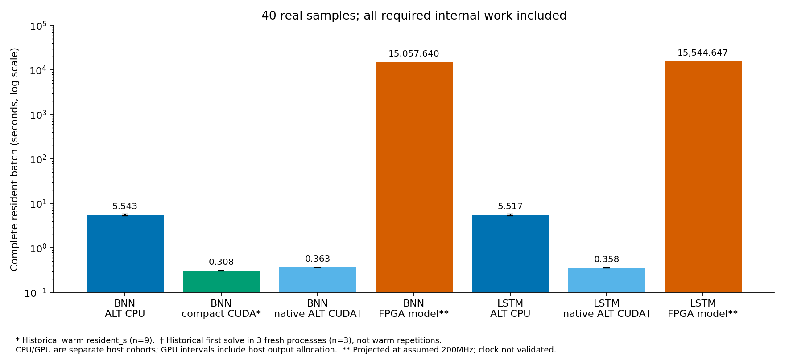
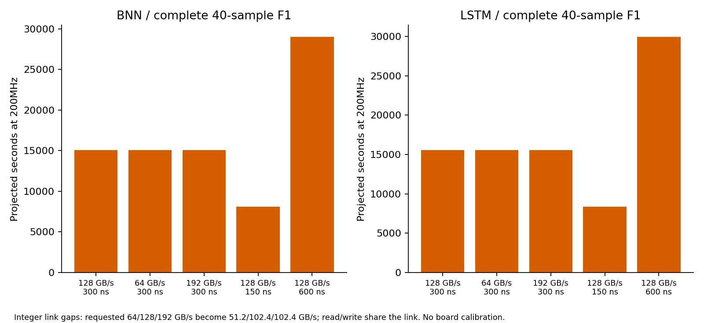
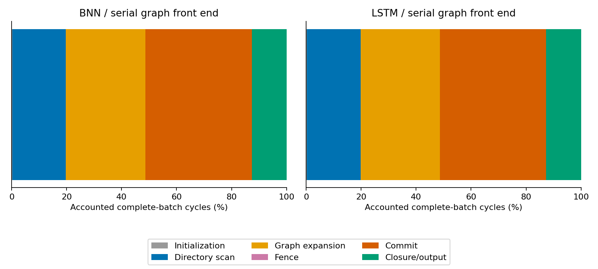

# 无实板 FPGA 方法重启：实际交付与负结果

本轮完成了单 owner RTL、8/64-owner 完整小图闭环、对应 F1 模型校准、BNN/LSTM 各完整 40 个 sample 的 12 项有限架构模拟，以及实际 native bridge/final-map 回接。**当前实现在声明的仿真情景下没有性能优势；整轮请求仍有未完成项**，见末节。没有把板卡、XRT、XPFM 或 shell 缺失用作实验停止条件。

基点 `7e63b917f37273f80c03327e024d86b797ee221b`；独立 worktree `/inspire/hdd/global_user/guoruiyuan-253208540291/FPGA_routing_acceleration/3D_FPGA_Interconnects_SIM_RESTART_R62`；分支 `accel/lookahead-fpga-sim-restart-20261112`。首项交付提交 `857bfce454a86947965f7dd706f643bc376f6cf9` 已单独推送。main、原稿、STRICT、旧 golden 和历史证据未修改。配置依据用户 YAML，模板、执行合同、输入路径/SHA 和全部正负尝试均保留。

## 实现与完整工作范围

固定 Q=1；64 个 `pair_lane` 实例和 64 个实际 owner；每 owner 为 4-way×32 sets×32B、32 MSHR、16 dirty slots、请求/响应 FIFO 各64。owner/set 地址公式正确，同行合并、全 pair FP32 最小值、脏写确认前 RAW 阻塞、全局 fence 均实体化。FP32 正数/+0 RN 加法另通过 100,006 对 XSim 独立核对。运行时输入从真实 CSR/node/cost/jobs/cell 数据生成；golden 只供输出检查，未提供硬件前沿。

**图前端每次只有一个 blocking 访存请求**，轮转给 lane，候选总线每周期最多一次传输。目录采用显式 `pending[N]` 扫描与 `closed[N]` 状态，4096 key 范围和524288 live member 上限；模板提出的 chunk pool 未采用。初始化、扫描、图访存、commit、closure、输出和 drain 全部计入。这是一个完整但低并行度的实现，不声称持续64边/周期，也不把其结果推论为所有 owner-reduce 架构都慢。相关实现选择与限制作出了公开记录。

最终版本为每个 lane 配置独立输入寄存器及弹性算术/输出级，全局fence同时等待两个级排空。综合和布线资源报告均核对到64个独立、含实质FP32逻辑和私有状态的lane，见 `independent_lane_coverage.json`。前一版共享输入缺少每lane的私有操作数状态，其层级资源也不能单独确认64套独立流水；已保留全部结果并明确中止被替代的OOC。修正后重新运行完整小图和12项大图模型。**图前端仍然串行，64套物理lane不等于当前能持续处理64边/周期。**

32 个共享物理服务通道承担所有数组流量，64 owner 不被当成64个独立端口。cache/queue/tag 状态均为实际 RTL。全核接口是带 ID/确认/背压的32B事务协议，非完整平台 AXI4/shell；外存参数是明确的 assumed 情景，`board_measured=false`。

## RTL、校准与保留的失败

首个单元交付包括完整有限存储 TB、五项功能回归、五种非法数拒绝、所有内存差分和周期日志；最初空闲 way 优先级不一致及修复前结果见首项证据。没有用单元周期冒充完整图周期。

完整 d3：8 jobs、42 waves；完整 d4：12 jobs、106 waves。8-owner XSim 与 Verilator 在latency=4 cycles的诊断情景下输出及周期一致；最终64-owner的两个批次使用中央latency=60 cycles，并由Verilator运行。4-cycle诊断不作为大图存储参数或缩放依据。d4 未用于模型调节；冻结签名和阶段误差保留。

最终RTL可执行文件还通过五项运行时配置拒绝测试：空nodes/jobs/cells、超上限nodes及proposal基址未对齐，均观察到DUT error且不发布完整输出。此测试不覆盖运行中的member容量溢出；该边界保护目前只有源码逻辑，未取得动态溢出RTL覆盖。

| 校准 | owners/latency cycles | RTL cycles | 模型 cycles | 总误差 | 全输出、读写事务 |
|---|---:|---:|---:|---:|---|
| native_d3_w8 | 8/4 | 1,460,380 | 1,434,462 | -1.7747% | exact |
| d3_rtl64_final_l60 | 64/60 | 10,610,838 | 10,584,974 | -0.2438% | exact |
| d4_rtl64_final_l60 | 64/60 | 63,827,952 | 63,667,518 | -0.2514% | exact |

完整小图也保留负结果。下列RTL秒数同样由**假设200MHz**换算，不能视为已支持频率下的硬件时间；CPU为实际9次warm测量，均执行完整batch。

| 完整小图 | ALT CPU mean ± sample SD，ms | RTL cycles / 假设200MHz，ms |
|---|---:|---:|
| native_d3_w8 | 0.068518 ± 0.037004 | 53.054190 |
| native_d4_w8 | 0.184812 ± 0.018432 | 319.139760 |

逐阶段误差保留在校准JSON中；RTL的startup/sample-switch/finish阶段包含JOB读取，模型将JOB读取归入initialization；模型原始阶段数组还未单列已计入total的4+2×jobs个控制周期。校准文件保留原始分解、补齐后的分解和合并阶段比较，未把归类差异当作免费reset。

模型直接执行 labels/proposals/pending 的闭环，不读预先的 golden frontier。每数组的读写、通道预算、RAW、write ack、outstanding、dirty slot 和 fence 均计时。无竞争阻塞扫描仅在条件满足时精确聚合其连续事务；没有免费复制/清空 N。覆盖的大图调度每 owner 最大一个在途 miss、模型 front backpressure=0；该稀疏请求域之外的饱和负载只具备单 owner 校准。F0 是同前端/存储的显式行 RMW 模型消融，**没有独立完整 F0 RTL 校准**。模型 fence 仲裁是有报告误差的事件近似。

## 当前完整原型 OOC（64 独立 lane、64 owner）

Vivado2022.2，`xcu280-fsvh2892-2L-e`。最终64-owner顶层资源：`{'luts': 767925, 'logic_luts': 472117, 'lutram': 295808, 'ffs': 159828, 'ramb36': 0, 'ramb18': 0, 'uram': 0, 'dsp': 7}`。全部内部图控制、算术、owner 与互连已纳入此 OOC。没有沿用旧核或 tile 频率。20% shell 预留仅为假设，不代表已验证配额。

| 同一最终 routed top | setup WNS ns | hold WHS ns | 全约束通过 |
|---|---:|---:|---|
| 200 MHz | -8.417 | -0.145 | False |
| 125 MHz 同 route 回退检查 | -5.417 | -0.145 | False |

同一route的内部寄存器路径单独检查：200MHz setup/hold slack为-8.417/0.01ns，125MHz为-5.417/0.01ns。关键端点及完整路径见内部时序报告，不将边界未路由警告混同于内部路径证据。

最差内部setup路径从`owners[26].service/requests/rp_reg[2]_replica/C`到`owners[26].service/dirty_reg[32]/D`；数据路径延迟为13.299ns  (logic 2.196ns (16.512%)  route 11.103ns (83.488%))。该owner内部路径本身未达标。当前串行扫描实现的完整工作量乐观界已经落后于软件，按合同第7节保留这一结果，未继续扩展流水/布局优化。

报告包含 setup/hold、unconstrained、DRC、route status 和约束；未添加 false paths 掩盖依赖。早期8-owner互连资源偏大，随后限制为实际 owner/channel 映射。被替代的64-owner全连接仲裁综合尝试明确中止，保留原因和日志，未写成工具/资源失败。先前 libudev/WebTalk 路由退出问题采用进程级 preload 解决，初次失败及复跑都保留。

`HD.CLK_SRC`未绑定到板级/shell时钟buffer位置，端口也未固定`HD.PARTPIN_LOCS`；保留Vivado关于时钟偏斜估计和边界路由/时序精度的警告，不作平台时序闭合主张。内部寄存器到寄存器的setup/hold、SLR资源与时钟源检查另存报告；20%接口/shell预留是设计假设，不能替代实际集成。

SLR0/1/2的CLB占用分别为85.05%/92.77%/56.11%，CLBM占用为91.42%/97.65%/67.78%；已用LUT占比分别为65.43%/72.49%/38.68%。已占用站点与已用LUT数量不同，SLR0/1没有20%完全空闲CLB/CLBM站点，不能把名义预留写成已通过的shell适配。实际跨SLR连线占用为9,574个SLL，两个相邻边界分别使用2,822和6,752个。完整数据及预留解释见`physical_audit.json`。

## 全量架构模型与敏感性

下表每行均为真实40个 sample，完整原始 ALT 输出逐字一致。周期可复现；秒数是 **cycles/假设200MHz，projected**，不是板测、不是 CPU 模型执行时间，也不是已通过全核时序的实测服务时间。

| 情景 | 完整 cycles | projected s @200MHz | F1命中率 | 全数组读写 TB | 输出 |
|---|---:|---:|---:|---:|---|
| bnn_F0_central | 3,012,021,147,121 | 15,060.106 | 0.000% | 1.533283 | exact |
| bnn_F1_bandwidth_192 | 3,011,527,924,278 | 15,057.640 | 85.450% | 1.496253 | exact |
| bnn_F1_bandwidth_64 | 3,011,538,905,301 | 15,057.695 | 85.450% | 1.496253 | exact |
| bnn_F1_central | 3,011,527,924,278 | 15,057.640 | 85.450% | 1.496253 | exact |
| bnn_F1_latency_150 | 1,616,413,239,306 | 8,082.066 | 85.450% | 1.496253 | exact |
| bnn_F1_latency_600 | 5,801,757,340,389 | 29,008.787 | 85.450% | 1.496253 | exact |
| lstm_F0_central | 3,109,432,843,463 | 15,547.164 | 0.000% | 1.582211 | exact |
| lstm_F1_bandwidth_192 | 3,108,929,429,228 | 15,544.647 | 85.407% | 1.544541 | exact |
| lstm_F1_bandwidth_64 | 3,108,940,656,064 | 15,544.703 | 85.407% | 1.544541 | exact |
| lstm_F1_central | 3,108,929,429,228 | 15,544.647 | 85.407% | 1.544541 | exact |
| lstm_F1_latency_150 | 1,668,702,265,291 | 8,343.511 | 85.407% | 1.544541 | exact |
| lstm_F1_latency_600 | 5,989,383,806,808 | 29,946.919 | 85.407% | 1.544541 | exact |

中央 read/write latency300ns；150/600ns为单因素敏感性。请求的64/128/192GB/s经整数周期 link gap 得到有效51.2/102.4/102.4GB/s，均低于32×32B×200MHz接口上限。128/192两项在本模型中重合，未伪造带宽收益。全部数组共享读写链路，等待已在周期中，没有再次叠加 bytes/bandwidth。

BNN 中央 F1命中率约85.45%，完整周期只比F0少约0.0164%。全局按节点扫描的顺序与先前原目录软件事务重放顺序不同，因此命中率也不同；没有继承旧46%或更早20.87%数据。主要瓶颈是串行图读取和全图 pending/commit/closure 扫描。当前实现未达到 FPGA 优势，负结果保留。

## RESIDENT_COMPLETE_BATCH_V2 软件边界

起止为各平台输入可消费到全部真实 sample 输出提交；排除外部转换、首次H2D/最终D2H；内部访存、初始化、波次控制、冲突、提交和排空计入。新 ALT CPU 为3独立进程×预热1次+测量3次，全部原始值保存。新CPU和历史warm cohort报告9个实际warm值的sample SD，另存进程身份和进程均值间SD；native CUDA首次solve cohort仅有3个值，单列说明。模型确定周期没有虚构SD。

新CPU主结果使用socket1的32–39核；本轮Vivado限制在socket0的0–15核。原先工具亲和性未限制的CPU样本另存为失败隔离尝试，不混入主统计。内存系统和共享主机上的其他用户仍未隔离。执行时曾有最多3个Vivado实现作业重叠，偏离模板的单作业限制；已记录于 `execution_deviations.json`，不把工具运行耗时用作FPGA性能。

| 输入 | 软件参考 | resident mean ± sample SD，s | cohort |
|---|---|---:|---|
| bnn_export | compact ALT CUDA | 0.308084763 ± 0.001496051 | historical R6.1 GPU worker, recorded resident interval; compact includes host output-vector construction |
| bnn_export | STRICT early-exit CPU wrapper | 8.566143395 ± 0.127163446 | historical R6.1 GPU worker, recorded resident interval; compact includes host output-vector construction |
| bnn_export | STRICT CPU wrapper | 8.590412099 ± 0.090747570 | historical R6.1 GPU worker, recorded resident interval; compact includes host output-vector construction |
| bnn_export | original ALT CPU (8 threads) | 5.543478304 ± 0.259687020 | new local FPGA tooling host; not paired with historical GPU host |
| lstm_s2 | original ALT CPU (8 threads) | 5.517003250 ± 0.239687207 | new local FPGA tooling host; not paired with historical GPU host |
| bnn_export | native original ALT CUDA | 0.362768004 ± 0.000287899 | historical R6.2 native first solve, 3 independent processes; no in-process warm repetitions; host output-vector allocation included |
| lstm_s2 | native original ALT CUDA | 0.358104462 ± 0.000844552 | historical R6.2 native first solve, 3 independent processes; no in-process warm repetitions; host output-vector allocation included |

历史compact CUDA/STRICT wrapper只读取真实`resident_s`字段，并核查源码计时边界。compact的历史计时仍含入口host输出vector构造，保留为完整区间的保守参考，未猜测扣除，不称为精确纯设备区间。旧基础CUDA6的E1和device timeline都包含最终D2H，明确排除于V2比值；旧0.309712337s未改名。原始ALT CPU本轮host与历史GPU host不同，不进行跨cohort配对统计。STRICT wrapper为额外参考，不等同于已补齐最佳 native STRICT/VPR 同范围计时。完整历史原始数据仍保存。

另复用BNN/LSTM原始表示native ALT CUDA的 `LA_LIVE.resident_s`：每图3个独立进程、各一次首次solve，完整40个sample；这两行SD来自3个值，**不是9次warm cohort**。它们已排除最终D2H、包含必需波次host控制，仍含入口host输出vector构造。它们是R6.1/R6.2 live原始表示CUDA参考，与旧cuda6基础实现分别保留，不能互相代名。

<!-- GPU_V2_SUPPLEMENT_BEGIN -->
## 授权恢复后的新 GPU V2 补测（2026-11-12）

启智授权已恢复；作业 `job-0afcca08-4376-45b4-9711-61940a922bad` 成功执行。实际 GPU 为 NVIDIA H100 80GB HBM3，CUDA 12.8，单卡10核配额，主机控制线程固定在8个不同物理核。基础与compact CUDA顺序运行，每个输入/实现3个独立进程，每进程1次预热加3次正式测量；共96个完整batch全部输出逐字一致，统计使用72个正式测量值。BNN/LSTM每batch均为真实完整40个sample。

基础CUDA新增resident终点，包含初始化、波次host控制、错误确认与设备输出提交，排除最终输出D2H。compact将入口host输出vector分配移出resident，算法和kernel不变。两者均排除外部准备/转换及首次H2D；保留原E1和新resident原始值，没有重命名旧E1。

| 输入 | CUDA实现 | resident mean ± sample SD，s |
|---|---|---:|
| native_d3_w8 | basic | 0.000312635 ± 0.000007526 |
| native_d3_w8 | compact | 0.000281051 ± 0.000004479 |
| native_d4_w8 | basic | 0.000488135 ± 0.000010959 |
| native_d4_w8 | compact | 0.000459745 ± 0.000011700 |
| bnn_export | basic | 0.312342177 ± 0.000721963 |
| bnn_export | compact | 0.304680242 ± 0.000359606 |
| lstm_s2 | basic | 0.311485814 ± 0.001153644 |
| lstm_s2 | compact | 0.306053250 ± 0.002376012 |

每行9次正式测量，另保留3个进程均值及其SD。CPU仍为先前本机测量，未声称新GPU与CPU同主机配对。新GPU数据取代“登录阻塞/未执行”的状态；历史数据、先前失败和图表原始来源保持不变，上方历史表与末尾原图不混入新cohort。当前FPGA实现的负性能结论不变。

补充原始日志、完整输出、编译源码/二进制、运行回执、资源查询及SHA索引见 [GPU补测证据](../results/fpga_sim_restart_20261111T231000Z/gpu_v2_supplement/index.json)。此前 `evidence_snapshot/index.json` 的源码/报告绑定对应提交 `cde531d0fb54a54e76e97aa6108fd4f237a1b847`；新索引单独绑定补测后的文件，未重写旧快照。
<!-- GPU_V2_SUPPLEMENT_END -->

## 冷调用与应用占比补充

`cold_call_supplement.json`将外部转换、首次H2D、一次入口控制、驻留服务、最终D2H及后处理逐项相加；不重复同步等待，K固定为1个真实batch。PCIe 8/16/32GB/s、转换0/1/2s等仅是明确的 assumed 情景，非CPU memcpy、GPU传输或FPGA实测。内部初始化留在resident时间中。job的不可变target计数在外部输入准备时生成，与软件基线Prepared范围一致；运行内仍计target读取、closure去重、输出更新。

五个外存情景均没有输赢转折。即完全忽略所有proposal流量、并乐观允许图控制器每周期1笔非proposal事务，BNN/LSTM在假设200MHz下的必要时间仍为187.985/193.996s，超过本轮ALT CPU均值5.543/5.517s。此界只否定**当前串行扫描实现**的优势前景，按合同第7节停止扩大该实现，不推论所有FPGA架构不可能。

历史同次native ALT CPU调用中，BNN/LSTM的resident分别占E2约62.29%/58.50%，占Process约9.31%/8.21%。分子分母来自同一条历史资格记录；这是模块归因补充，不是本模型或FPGA的应用加速比。

## native 回接与 QoR

使用模型实际输出、原始 ALT native输入捕获和现有 import bridge。没有改写旧golden，也没有把ALT差异声称为STRICT等价。实际回接在前一版完整输出上执行，完整核对40个sample并完成native FULL检查/STA，最终wire map SHA与既有ALT资格完全相同。独立lane修正后，全部新模型输出逐字等于实际已导入的输出，输入数组和bridge未变，因此按合同允许复用这一回接/QoR；有独立SHA核对记录。回接为离线正确性实验，非FPGA live backend计时。

| 输入 | 最终 wire map | CPD ns | wirelength | 检查 |
|---|---|---:|---:|---|
| bnn | exact | 11.0943 | 1,537,866 | FULL pass |
| lstm_s2 | exact | 11.7483 | 1,712,223 | FULL pass |

## 未完成项与证据范围

- 原 VPR 多线程与最佳 native STRICT CPU 的匹配 V2核心区间仍为 `not_evaluated_same_scope`，不拿其E2与模型相除。
- 当前全核的时序结论见上表；若未闭合，频率保持假设，不能提升为物理支持的 FPGA服务时间。图前端仍是主要性能限制。
- 覆盖限制：F0为完整模型消融，未做独立完整F0 RTL校准；动态member容量溢出也尚未取得RTL测试覆盖。

可复现代码：[closed_loop](../accel/lookahead/fpga_sim_restart/closed_loop/README.md)。完整差分、原始计时、周期/事务、OOC、native日志及全输出见 `results/fpga_sim_restart_20261111T231000Z/evidence_snapshot/closed_loop`；大DCP仅保留本机路径及SHA，未伪称已经上传Git。所有尝试与未完成项都有机器可读状态。

