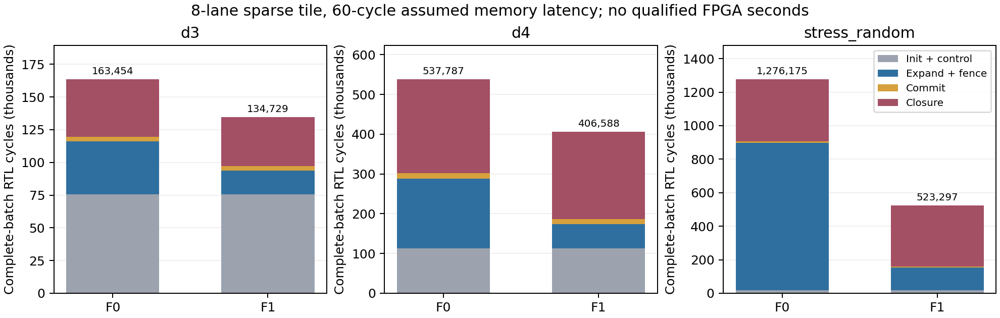

# SPARSE_STREAMED_ALT_V2：8-lane 稀疏闭环与扩展判定

本轮在 `fe659f008fc58c913bb1c0232d9898caf79fd524` 上建立独立 worktree / 分支 `accel/lookahead-sparse-stream-r1-20261112`。交付了实际运行的 **8-lane / 8-owner / Q=1** RTL：有界桶目录、稀疏 active/changed/closed 路径、运行时 cost 预载、多 parent / 多在途 CSR 前端、8 路 owner 仲裁及同步存储更新。不是只改资源账本，也没有把旧单候选总线乘以 64。旧稿、STRICT、golden、历史证据和原目录未跟踪指导文件未修改。

完整小图和并发域验证通过，但当前结构没有形成优于最快软件的结论。依据合同 P3，用本轮重新产生的 BNN/LSTM 全部 40 sample 工作量和结构最大服务能力计算，假设 64 owners、8 个独立闭包服务器、200 MHz，**仅展开和闭包的乐观必要时间已分别为 0.3937435 / 0.40064995 s**，超过已测 compact CUDA 0.304680242 / 0.306053250 s。因此保留 8-lane 实现及物理结果，不继续复制此结构做 64-lane OOC。这个界不是完整大图架构模拟预测，也不否定不同流水结构的 FPGA 实现。

源码与复现入口：[README](../accel/lookahead/fpga_sparse_stream/README.md)、[实验配置](../accel/lookahead/fpga_sparse_stream/config/experiment.json)、[逐项数据](../results/fpga_sparse_stream_20261112/evidence_snapshot/analysis.json)。本轮没有重复 GPU 授权或启动新 GPU 作业，复用 fe659f0 已完成的 V2 补测。

**执行语义与容量。** 桶键 4096 个；每 bank 512 个节点、1024 个物理 member、512 个 changed ID、512 个 closed ID。active 通过有限握手和每 lane 4 个 parent context 向前端流送。owner 保留 4-way × 32 sets × 32B、32 MSHR、16 dirty slots、64-entry 请求/响应 FIFO；router 是 8 个独立有限队列，允许同周期向多个目的 owner 发射。每 bank 有 16 个带 ID 的 commit 读上下文，8 条 bank 内提交处理路径。路径数不等于可持续 IDs/cycle。

changed membership 独立于 cache tags。first-mark 与列表追加在同一时钟沿取得容量；miss 的候选在 baseline 返回后才逐 sector 比较；纯 fill 不标记改善。同一节点多次改善只登记一次。fence 等待前端、候选、MSHR、脏写 ACK 和 changed append；提交读最终 proposal，label 写回与 pending/目录插入完成后才清 membership。每个小图 wave 都独立核对 `proposal_home == label`、wave 快照不变、changed 队列无重复且等于最终严格改善集合。golden 不提供 frontier 或 changed IDs。

准备后 CSR 按原邻接顺序执行 eligible：0 跳过，−1 终止该行；描述符是显式准入的 dst28/cost4。cost 表运行时加载，当前原生输入只读 3 个 32B beat，计入一个完整 batch 的初始化，随后跨 sample 保留。原 node/cell 元数据仍供闭包使用。每 sample 的输出写入有限的 **64 samples × 64 cells × 64 bits** 片上 batch 数组，所有结果留到统一的最终读回。节点/单 sample cell/cost/sample 上限分别为 4096/64/16/64；超出由准入层拒绝，不截断。

**严格计时边界。** 采用 RESIDENT_COMPLETE_BATCH_V2。全部不可变输入在 batch 启动前驻留；包含 reset、runtime cost 预载、每 sample 初始化、内部访存、冲突、wave 控制、提交、闭包、输出写入和排空。只把外部转换、首次 H2D 和最终 D2H 放在 resident 外。早期 testbench 使用逐 sample 元数据窗口和逐 sample 输出读回；审计后已改正，并新增有限 batch 输出 RTL。旧版本的源码、结果和中止原因单独保留，最终证据只选 `batch_f1` / `f0_batch`。修正后 resident 周期相同，源码和物理证据仍重新绑定。

有限外存测试模型分配 25 个读写共享服务：8 owner、8 frontend、8 init/commit、1 cost/closure，总数不超过假设的 32 物理通道。每服务最多 64 个在途 32B 事务、最小 2 周期发命令间隔，随机背压、乱序响应、写到 ACK 才可见。所有数组共用这些明确分配的额度。sample 命令由 tile 边界的有限 64-job 本地预载命令服务提供，每次 start 接收计 1 cycle；外层命令生产器和 shell 未纳入 tile OOC，不能把这一接口假设当作主机经 PCIe 逐 sample 调度的实测开销。200 MHz 下 25 端口名义上限 80 GB/s，未声称实测 HBM；16/60/120 周期延迟及 0–6 周期 jitter 均为假设。频率未资格化时，下面只列周期。

**完整 RTL 与 F0/F1 消融。** 下表均为 60 周期基础延迟，包含全部真实 sample；两个压力图各 2 sample。F0 使用同一新前端、稀疏调度、commit16 和有限存储，仅关闭 owner cache/merge；保留 32 并发事务、16 写槽及同行直到 ACK 的串行约束。

| 完整输入 | F1 resident cycles | F0 resident cycles | F1 内核外存字节 | F0 内核外存字节 |
|---|---:|---:|---:|---:|
| native_d3_w8，8 sample | 134,729 | 163,454 | 378,016 | 450,304 |
| native_d4_w8，12 sample | 406,588 | 537,787 | 1,030,272 | 1,520,224 |
| 顺序目的行压力图 | 398,240 | 2,154,358 | 1,518,464 | 7,454,464 |
| 随机目的行压力图 | 523,297 | 1,276,175 | 1,619,296 | 7,641,984 |

| F1 输入 | 展开期平均候选/cycle¹ | commit 期平均 IDs/cycle | 最大发射/提交数每周期 |
|---|---:|---:|---:|
| d3 | 0.190 | 0.260 | 5 / 4 |
| d4 | 0.349 | 0.349 | 7 / 5 |
| 顺序压力图 | 1.465 | 0.751 | 6 / 4 |
| 随机压力图 | 1.406 | 0.751 | 7 / 3 |

外存字节包含 proposal 读写（含初始化和 commit）、CSR row/edge、cost、cell/type 六类设备端事务，排除 H2D/D2H，不包含片上 RAM 端口活动。片上端口的同步延迟和服务互斥计入模型与 RTL 周期，实际映射由 RAM 报告核验。

各流量项的原始 32B 事务数如下（F1，60 周期情景；proposal 写包括 sample 初始化和脏写回，proposal 读包括 fill 与 changed commit）。字节量为事务数乘 32。

| 完整输入 | proposal 写 | proposal 读 | CSR row 读 | CSR edge 读 | cost 读 | cell/type 读 |
|---|---:|---:|---:|---:|---:|---:|
| d3 | 8,672 | 1,348 | 906 | 356 | 3 | 528 |
| d4 | 15,031 | 6,734 | 4,787 | 2,487 | 3 | 3,154 |
| 随机压力图 | 3,438 | 6,944 | 6,866 | 27,960 | 1 | 5,394 |

¹ 展开期定义为 POP+DRAIN；fence、初始化、commit 和闭包另计。全 batch 吞吐、发射/接受/逻辑退休/parent 出队直方图、每数组事务、每通道高水位及 stall 原值均在 JSON/周期日志。MSHR 合并可能一次退休多个逻辑请求，不能将退休 burst 当作算术发射能力。实际平均提交率尚未达到原设想的 2 IDs/cycle/tile。

一次有依据的修复将每 bank 单在途 commit 读改为 16 个上下文，d3/d4 的 resident 周期从 146,553/458,222 降至 134,729/406,588。修复保留 ACK 后清标记规则；没有借放宽 wave 边界换取周期减少。余下主要限制已经转移：d3 初始化 75,518 周期，d4 闭包 219,764 周期；随机压力图闭包 362,888 周期。闭包仍是 tile 内集中服务，初始化 proposal 写仍逐行等待 ACK。

**并发与容量核验。** 单 owner 组件测试 4800 个请求，完整最终存储和 changed 集合一致，MSHR/dirty/outstanding 峰值 32/16/44，合并 166，实际为 **37,067 cycles**。完整 d4 的 MSHR 峰值 10；顺序压力图主要命中缓存，仅 1，不能冒充饱和 miss。随机图 F1 在 60/120 周期延迟下达到 18/28，F0 达到 32；请求 FIFO 达到 64，parent context 达到 4，存在真实路由冲突和下游背压。

此外，将 owner 与真正的 changed RAM 队列连接，用 768 个 owner-local 行超过 128 行 cache 容量，完成两 wave、4800 请求的有限存储测试：2554 次 fence 前脏驱逐，3316 次 sector 改善事件对应逐 wave 去重后合计 2793 个 changed ID，40119 周期；MSHR/dirty/outstanding 峰值 32/16/45。逐项核对全部 768 行（包括未更新行）存储、驱逐/重填后列表仍无重复、提交读取最终值所需的完整写 ACK fence、以及延迟 7–11 周期的提交 ACK 前标记不清除。此组件测试的 changed CAP=4096，只用于覆盖超过缓存容量的语义组合，不冒充 tile 的 CAP=512 校准或物理实现。

定向输入覆盖 eligible skip/break、边界 beat、同目的/同行冲突、同 bucket 重入、重复 changed、乱序响应和 full FIFO。独立 owner 测试另覆盖 dirty 回访、RAW 到写 ACK、命令背压稳定、32 MSHR 饱和。三个运行中缩容测试分别令 member、changed、closed 容量为 2，均报 DUT error 且不发布部分输出。64-sample 边界测试完整通过，65-sample 被准入层拒绝。成功条件是 `done && !error`，错误后须丢弃整个 batch 并 reset。

新手写 C++ 模型显式执行同样的有限队列、MSHR、dirty slots、RAM 端口延迟、parent contexts、路由仲裁和 wave 事件；不调用 RTL，也不读取 golden frontier。F1 的四个完整输入在 16/60/120 周期下，以及 F0 的四个完整输入中央点和随机图 120 周期点，均与 RTL 的总/阶段周期、逐周期日志、提交序列、事务、高水位和 stall **完全一致**；64-sample 边界也一致。0 误差是这些配置和刺激上的实测结果，不是普遍证明，更不是继承旧 −0.25%。RTL 与模型共用外存驱动及检查器，另用不同存储调度的 XSim 完成 d3 全 batch 输出交叉核对。F0 的物理时序没有单独实现，不借 F1 OOC 替代。

保留的失败尝试包括：BNN 的 touched 核验 oracle 最初容量不足（仅将 oracle 改为 N，硬件列表容量未改）；初始压力图 testbench 的固定地址区域重叠（改为按输入大小分配）；member=2 的初始化计数宽度和调试别名编译问题；XSim 动态文件名读取失败（改为固定文件名，并要求显式 PASS）；测试脚本 prepared 路径错误；上述 batch 驻留边界修正。失败日志和源码快照均保留，失败尝试不混入正式周期或完整输出结论。

**本轮真实大图工作量。** 新功能参考完成 BNN/LSTM 各 40 sample，全部输出逐位匹配原 ALT。它分别为物理 member 池和 active/changed/closed 列表限定 524288 个条目；touched 是独立核验 oracle，容量 N，不作为硬件列表。逐 wave changed 数、changed-line 数、stale entries、容量峰值均重新记录。

| 完整 batch | waves | candidates | touched | changed | closed 实际遍历总数 |
|---|---:|---:|---:|---:|---:|
| BNN | 2,161 | 1,286,937,147 | 335,766,497 | 104,210,988 | 102,747,910 |
| LSTM | 2,200 | 1,309,512,712 | 342,191,810 | 106,141,205 | 104,550,024 |

changed-only 比 touched-only 少提交 68.963% / 68.982% 的 ID；这是精确语义与工作量减少，不等于完整 batch 的同百分比加速。MIN/ACTIVE/COMMIT/CLOSE 不再全 N 扫描，必要的 sample 初始化和每 owner 128 行 cache flush 仍计入。功能参考的 wall time 含大量检查，不能当 CPU 基线或 FPGA 时间。

| 物理容量峰值（分别计数） | BNN | LSTM |
|---|---:|---:|
| 全局 member / active | 214,711 / 194,063 | 218,004 / 198,225 |
| 全局 changed / closed | 214,441 / 350,777 | 217,898 / 355,380 |
| 64 路行 hash 下最拥挤 bank 的 member / active | 3,495 / 3,143 | 3,531 / 3,206 |
| 64 路行 hash 下最拥挤 bank 的 changed / closed | 3,480 / 5,600 | 3,509 / 5,665 |

64-bank 表是功能占用审计，不是已实现的 64-owner RAM 或其时序证明。8-lane 原型的 4096-node 本地 label/pending 存储不能容纳 410 万节点；没有把 C++ 数组无限放大后称为可实现硬件。

准备后的 CSR 分别为 186,191,976 / 189,273,912 B，转换约 0.2164 / 0.2097 s（仅 CSR 转换，不含文件输出）。包含必要 node/cell/jobs/cost 数据的完整 prepared 文件则为 **908,252,232 / 922,618,584 B**；不能把 CSR 大小当作全部 H2D 量。输入、表示和完整输出 SHA256 均保留。准备后 CPU 功能参考已验证；没有新增 prepared CUDA 性能基线，因此不把表示压缩、eligible 预处理的潜在软件收益算成独有硬件贡献。cold/E2 至少还需这些外部转换、传输和最终读回，本轮未给出已验证的完整 FPGA E2 秒数。

**最终 tile 物理结果。** Vivado 2022.2、U280 `xcu280-fsvh2892-2L-e`、无 shell OOC，使用 5 ns 时钟、输入/输出 max 0.5 ns 与 min 0.1 ns，未添加 false path。最终 `resident_batch_commit16` 完成综合、布局布线及报告；211,611 个可布线网络全部完成，routing errors=0。DRC 无错误，仅 RTSTAT-10（无可布线负载）警告；check_timing 的未约束端点、缺失 I/O 延迟、组合环等 12 项均为 0。[机器可读物理审计](../results/fpga_sparse_stream_20261112/evidence_snapshot/physical_audit.json)绑定对应报告 SHA256。

| 最终 routed 资源 | 实际值 |
|---|---:|
| LUT（其中 LUTRAM） | 243,739（39,776） |
| FF | 75,203 |
| RAMB36 / RAMB18 | 168 / 32 |
| 等效 BRAM tile / URAM / DSP | 184 / 0 / 0 |

每 owner 实际为 13 RAMB36 + 1 RAMB18：cache payload 4 RAMB36、dirty payload 4 RAMB36、请求 FIFO 1 RAMB36 + 1 RAMB18、响应 FIFO 4 RAMB36。容量碎片和端口成本按实际计入。目录、member、closed、changed 和 FIFO 已使用 BRAM；label/pending、部分上下文及 batch 输出仍有 LUTRAM 映射，不能因 `ram_style` 属性便声称全部为 BRAM。综合阶段的 244,521 LUT / 75,123 FF 与最终 route 数值分开保留；所有打印出的非 INFO 综合消息已在诊断表中逐项审阅，没有通过 KEEP/DONT_TOUCH 掩盖资源问题。

**200 MHz 时序失败：WNS −7.035 ns，WHS −0.048 ns。** 最差内部 setup 从 `banks[4].bank/groups_reg[10]` 到 `command_reg[0]_rep/CE`，数据延迟 11.930 ns，其中 logic 4.519 ns、route 7.411 ns（62.119%），52 级逻辑；对应未流水化的分层桶选择和全局最小值控制路径。高扇出报告中 local reset 达 48,139 个负载，目录控制达 4,137，输出索引各 4,096。同步 owner payload 已落到 RAM，目录优先选择与控制广播仍需结构修复。

最差 hold 是 `rsp_id[99]` 到 bank0 commit context 的 LUTRAM 写地址，在当前 0.1 ns 最小输入延迟约束下为 −0.048 ns；内部寄存器路径最差 hold 为 +0.019 ns，应区别对待。相同 DCP 的 125 MHz 约束复查为 WNS −4.035 ns、WHS −0.048 ns，**也未通过**；没有重新实现、没有从 slack 反推可用 Fmax，也没有把旧 cycles 直接除以新频率。只读复查前后 DCP SHA256 相同。

OOC 未提供完整 shell 的 `HD.CLK_SRC` 时钟源位置，工具对此给出提示；不能把这些模块报告当作完整平台时钟/skew 签核。复查的 `all_registers` 大集合查询另产生 Vivado 12-4439 性能警告，所有报告仍正常完成，原始日志保留。此前单 owner、旧 commit 和逐 sample 输出版本的 OOC 中止记录也保留，但不充当最终版本的时序证据。最终 DCP 为本地原始证据，快照清单保留其路径、大小及 SHA256。

**扩展门与软件对照。** `optimistic_bound.py` 对每个实际 wave 分别取整：owner 请求至少消耗分离的 IDLE 和 TAG 两周期，即 64 owner 最大 32 candidates/cycle；闭包接收至少经历 close_state 0、1、3，乐观赠予 8 个独立服务器后最大 8/3 records/cycle。展开与闭包受语义屏障分隔，必须相加；完全省略 commit、初始化、外存、跨 tile 通信、输出冲突和 drain 使下界更乐观。

| 输入 | 乐观必要 cycles | 必要 seconds @假设200MHz | 已测 compact CUDA V2 mean ± sample SD，s |
|---|---:|---:|---:|
| BNN | 78,748,700 | 0.3937435 | 0.304680242 ± 0.000359606 |
| LSTM | 80,129,990 | 0.40064995 | 0.306053250 ± 0.002376012 |

分母来自结构最小服务间隔，不是用上表实测平均服务率伪造上限。仅要抵消这两个阶段已需要约 258.46 / 261.82 MHz，仍未计其它工作；没有据此宣称该频率可实现，也没有把旧周期随意除以新频率当性能模型。按照合同 P3，停止扩展这个固定结构，下一项结构工作应针对 owner 接收/标签流水、集中闭包、初始化与 bank metadata 服务；当前 tile 的 reset/fence/done 仍是局部广播，尚未完成分层寄存器树与桶目录最小值路径的流水修复；这是明确保留的实现缺项。64-owner 还需要真正的物理通道共享及大图 label/pending 存储。

已有 basic CUDA V2 为 BNN 0.312342177、LSTM 0.311485814 s；original ALT CPU 8 threads 为 5.543478304 / 5.517003250 s，CPU/GPU 来自各自已记录 cohort，非同主机配对。它们仅保留为匹配范围参考。原 VPR 多线程、最佳 native STRICT 的同范围计时仍未补齐，不宣称胜过它们。没有将旧 E1 改名为 V2。

**证据范围和未完成项。** 已有独立 8-lane 完整 batch RTL、F0/F1、小图及高并发重新校准、有限内存与动态容量测试、完整 BNN/LSTM 功能工作量、准备后身份和条件性结构下界。完整 64-lane OOC、64-owner 同配置 RTL 校准、BNN/LSTM 大图有限服务逐周期预测及其 F0/F1/内存敏感性未执行，受 P3 固定结构扩展门限制；不能将本轮功能运行或下界冒充这些结果。没有板测，`board_measured=false`。所有正负结果、版本替换和测试平台修正均保留；论文定位只支持本轮验证过的协议、结构和工作量减少，不支持 FPGA 完整 batch 加速主张。
