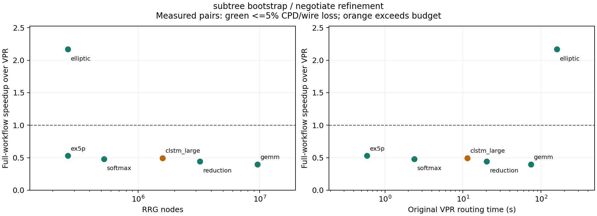

# 2026-10-27：时序语义与 GPU 常驻状态修复

本轮最终子树配置已完成三次确认：elliptic 完整流程加速 2.181–2.247×，中位数为 GPU 76.042 秒、原 VPR 167.951 秒，CPD −10.40%、线长 −25.91%。最新六电路复测为 6/6 合法、5/6 满足 5% 质量预算；CLSTM 的 CPD +9.41% 未达标，尚未发现随规模增长的加速交叉点。CPU 后端对照也已完成，质量与路径差异见末节。

下文保留当日第一轮冻结实验的原始结论；最新六电路、最终子树重复确认和各项优化的证据列在后半部分，所有失败记录均保留。

四项修改已在 `cpu_target` / `cuda_target` 实现：逐连接 STA 派生关键度、源点到树节点的延迟前缀、带合法停止条件的目标窗口搜索、GPU 常驻占用/历史的稀疏更新，以及有限拥塞代价与不可达哨兵的分离。算法和适用范围见 [实现说明](target_router.md)。

六电路双轮反馈实验得到 4/6 个合法结果。ex5p、softmax、CLSTM 的最终 CPD 与 VPR 相差约 0–3.2%；elliptic 的 CPD 和线长均优于 VPR。reduction、GEMM 首轮达到 600 秒进程上限，没有完整候选。双轮流程仍没有对 VPR 的端到端加速点。

## 双轮主实验：包含失败的完整记录

同一 H100 worker 顺序执行锁定原 VPR、旧 CUDA、新目标 CUDA；固定架构、打包网表、布局、端点、通道宽度和资源图。每种方法一轮试跑，最多 200 次拥塞迭代，每个路由进程最多 600 秒；新目标最多两轮。单次试跑不代表跨种子或跨电路的稳定性。

初始化关键度为 0.5；反馈只取自身上一轮合法树的原生 STA。最终选择预先规定的 CPD×线长最小合法检查点。下面的完整流程时间累计所有尝试、审计、导出、FULL/STA 和反馈；没有只计选中轮次。离线投影与哈希核验单列在运行记录，不计入在线流程。

| 电路 | 原 VPR CPD ns | 新 GPU CPD ns | CPD 变化 | 线长变化 | VPR 完整流程 s | 新 GPU 完整流程 s |
|---|---:|---:|---:|---:|---:|---:|
| ex5p | 5.61388 | 5.71540 | +1.81% | -2.02% | 5.78 | 23.48 |
| softmax | 7.63947 | 7.63947 | +0.00% | -2.01% | 16.28 | 110.86 |
| clstm_large | 6.58269 | 6.79143 | +3.17% | -2.09% | 61.60 | 548.81 |
| reduction | 11.10380 | 首轮超时 | — | — | 119.58 | 600.29（失败） |
| gemm | 13.26670 | 首轮超时 | — | — | 402.38 | 600.63（失败） |
| elliptic | 11.28950 | 9.67003 | -14.34% | -25.27% | 165.18 | 233.10 |

旧 CUDA 在 CLSTM 跑满 200 次后仍超用 2；新目标两轮分别在第 11、17 次迭代得到合法解。elliptic 旧 CUDA 最终超用 313，新目标两轮分别在第 78、61 次得到合法解。原 VPR 的 elliptic 在第 194 次完成。reduction 旧 CUDA 虽然合法，CPD 为 32.5707 ns；新目标本次超时，不能宣称已经改善该电路的质量。

| 电路 | VPR 主体 s | 新 GPU 主体合计 s | VPR 搜索 s | 新 GPU 搜索合计 s |
|---|---:|---:|---:|---:|
| ex5p | 0.590 | 6.852 | 0.371 | 4.462 |
| softmax | 2.290 | 58.332 | 0.390 | 32.756 |
| clstm_large | 11.170 | 383.196 | 3.966 | 245.979 |
| reduction | 20.160 | 缺失（超时） | 3.871 | 缺失（超时） |
| gemm | 73.420 | 缺失（超时） | 22.023 | 缺失（超时） |
| elliptic | 159.250 | 210.999 | 153.517 | 145.748 |

内部主体计时不含目标后端的静态模型/GPU 初始化；路由进程时间包含这些成本。搜索计时是同步完成的主机墙钟，含调用和回传，不是纯 kernel 事件时间。对端到端结论以完整流程为准。超时没有内部完整计时，不能将 600 秒当作其搜索时间。

## 搜索和状态更新的实际效果

每次目标查询按窗口和 `g+h` 剪枝；满足全体待处理标签下界不小于已知目标代价才结束。cooperative kernel 在设备上完成轮间循环。占用与历史更新按修改节点上传，但窗口节点列表仍由 CPU 生成并上传。

| 电路/方法 | 累计 H2D GB | 前沿访问次数 | 稀疏占用/历史 MB | 窗口列表 GB |
|---|---:|---:|---:|---:|
| softmax/legacy_cuda | 63.795 | 8,730,717,144 | 不适用 | 不适用 |
| softmax/target | 23.502 | 387,133,506 | 6.708 | 23.276 |
| clstm_large/legacy_cuda | 581.995 | 72,691,429,542 | 不适用 | 不适用 |
| clstm_large/target | 136.546 | 4,662,062,828 | 19.338 | 135.864 |
| elliptic/legacy_cuda | 68.304 | 15,853,857,223 | 不适用 | 不适用 |
| elliptic/target | 65.879 | 2,350,320,742 | 23.119 | 65.730 |

新目标计数合计两轮；旧版计数来自其一次完整尝试（包括 CLSTM/elliptic 的非法结果）。旧前沿次数、新版实际展开次数和 VPR 堆弹出不是等价操作，不能用次数比当速度比。CLSTM 占用/历史上传已经降到约 19 MB，而两轮窗口列表仍约 136 GB；常驻状态改造生效，但仍有明显传输与主机窗口处理成本。

新目标按终端逐次发起搜索，关键度在合法轮次之间刷新，尚无跨终端批量搜索或逐拥塞迭代的时序反馈。其几何下界也比完整原生 lookahead 简单。上述结构解释了为什么减少状态传输和展开次数后，总耗时仍可能增加；大案例超时前缺少更细的进度，不能为其杜撰准确耗时分解。

## 保持目标函数的算术优化

把饱和乘法中的逐因子 64 位除法改为有界乘法，数学目标不变。独立同机实验对 ex5p、softmax 各做三次配对，包含原 VPR、旧 CUDA、改写前/后的目标后端，共 24 次流程。六组改写前后配对的最终路径哈希全部一致。

| 电路 | 改写前搜索合计 s | 改写后搜索合计 s | 改写前完整流程 s | 改写后完整流程 s |
|---|---:|---:|---:|---:|
| ex5p | 4.459 | 3.712 | 23.604 | 22.970 |
| softmax | 32.480 | 28.013 | 110.182 | 108.308 |

表中为三次中位数；这项算术改写使搜索约快 1.20× / 1.16×，完整流程仅小幅改善。它不是对 VPR 的同倍率加速。当前代码包含此改写；六电路主表使用此前冻结的除法版本，未混用不同版本的时间。

## 单轮拥塞案例确认

主实验 elliptic 的第零轮完整开销为 145.609 秒，CPD 12.3349 ns、线长 72,966；相对 VPR CPD +9.26%、线长 −26.47%。它是有利的单轮检查点，但主实验实际执行了两轮，不能把它的时间当作双轮流程总时间。

因此另行预先固定单轮、关键度统一 0.5、无 STA 反馈、三次轮转顺序配对、CPD/线长各不劣于 VPR 10% 的确认协议。三组确认均通过；这是 elliptic 固定种子/布局下可重复的拥塞案例加速点，不是随规模增长的普遍交叉点。

| 重复 | VPR 完整流程 s | GPU 完整流程 s | 配对加速比 | CPD 变化 | 线长变化 |
|---|---:|---:|---:|---:|---:|
| 1 | 163.079 | 137.002 | 1.190× | +9.26% | -26.47% |
| 2 | 169.836 | 136.743 | 1.242× | +9.26% | -26.47% |
| 3 | 162.386 | 136.746 | 1.188× | +9.26% | -26.47% |

三次候选路径哈希相同，均零超用、全部连通并经原生 FULL/STA。完整流程中位数为 VPR 163.079 秒、GPU 136.746 秒；配对加速比中位数 1.190×。GPU 主体中位数 125.826 秒，对应 VPR 157.220 秒。

这一配置接受约 9.3% 的 CPD 增长，因而满足 10% 预算、未满足 5% 预算；线长改善约 26.5%。它未使用 STA 反馈轮，不能把双轮方案较好的最终 CPD 与该单轮时间组合。双轮 elliptic 得到更好的 CPD/线长，但完整流程仍慢于 VPR。

[确认报告](../results/h3d-target-single-20261027-184034/report.md) · [预声明条件核验](../results/h3d-target-single-20261027-184034/confirmation.json) · [原始产物核验](../results/h3d-target-single-20261027-184034/verification.json)。

## 验证和范围

H100 上四项 CTest 全部通过，其中新目标搜索含 3,240 个独立 Bellman–Ford 目标代价检查，覆盖 CPU、主机逐轮 CUDA、常驻 CUDA；旧增量 CUDA 的 18,600 条 oracle 路径也通过。本机 CPU 三项 CTest、Python 八项适配器/统计回归测试通过。完整候选另经投影审计和锁定原 VPR FULL/STA。

主实验已独立核验 19 份原生检查日志、15 份候选文件、选中轮次和冻结代码；五个失败尝试保留。算术对照已核验 36 份原生检查日志、30 份候选文件与参考二进制。两组任务均由平台确认成功结束，输入和代码哈希核验通过。单轮确认的六份原生检查日志、三份候选也已核验，任务成功结束，该轮验收时工作目录的后端源码与其冻结版本一致。任务完成不等于所有电路成功。

延迟模型限于已检查的零 RC、buffered 开关架构，延迟量化为 1 ps；不是一般 RC 树的电容回推模型。关键度是原生 slack 派生优先级，不是 VPR 内部公式的逐项复刻。有限惩罚仍有数值上限，只是与不可达严格区分；不存在“无界拥塞代价”的承诺。HLS 保持旧目标，本次没有新的 FPGA 上板结果。

原始产物：

- [六电路报告](../results/h3d-target-scale-20261027-171851/report.md)；[完整 JSON](../results/h3d-target-scale-20261027-171851/summary.json)；[独立产物核验](../results/h3d-target-scale-20261027-171851/verification.json)。
- [算术配对报告](../results/h3d-target-arith-20261027-173944/report.md)；[核验](../results/h3d-target-arith-20261027-173944/verification.json)。
- [单轮确认协议](../results/inspire/target-single-20261027-184034/protocol.json)；[任务入口](../results/target_single_run.json)。

## 后续优化：5% 质量预算的三次确认

最新实现将空间窗口 CSR 索引常驻 GPU，并使用扣除线段跨度的一致性下界；STA 反馈前后保留同一个路由进程和 GPU 上下文。初始合法树建立后，仅选择关键连接进行协商式细化，允许暂时超用并修复冲突。若协商失败，恢复上一合法森林及设备占用，失败尝试仍计时。算法与恢复规则见 [实现说明](target_router.md)。

硬容量细化的 elliptic 双轮、三轮试跑都停留在 CPD +5.40%，未通过 5% 门槛。协商式细化试跑达到 CPD −10.42%，随后预先固定双轮、初始整网拥塞修复、最多 2048 个关键度不低于 0.7 的连接、三次轮转顺序配对，以及每一对均须完整流程加速且 CPD/线长各退化不超过 5% 的确认协议。该确认与前面的单轮 10% 预算实验是不同配置。

| 重复 | VPR 完整流程 s | GPU 完整流程 s | 配对加速比 | CPD 变化 | 线长变化 |
|---|---:|---:|---:|---:|---:|
| 1 | 162.930 | 115.659 | 1.409× | −10.42% | −25.12% |
| 2 | 162.337 | 114.960 | 1.412× | −10.42% | −25.12% |
| 3 | 162.870 | 114.598 | 1.421× | −10.42% | −25.12% |

三对全部满足预声明条件。最终 CPD 为 10.1136 ns，对照 VPR 为 11.2895 ns；线长为 74,308，对照为 99,232。最终路径哈希三次一致，均全部连通、零超用，并通过原生 FULL/STA。完整流程中位数为 GPU 114.960 秒、VPR 162.870 秒；配对加速比中位数 1.412×。这证明了 elliptic 在当前固定架构、布局和种子下可重复加速，尚不能外推到其他布局、种子或更大电路。

时间包含两个反馈轮次的路由、图与上下文初始化、独立审计、原生 trace 导出、FULL/STA、关键度生成和会话退出。每次第二轮的静态空间索引上传量均为零。核验器检查了 9 份原生日志、6 份候选、固定输入、轮转顺序、检查点选择和全部轮次计时；源码与输入的运行前后哈希一致。离线投影、侧文件准备和实验哈希核验仍单列，不计入在线流程。

[三次报告](../results/h3d-target-confirm5-20261027-211729/report.md) · [确认条件核验](../results/h3d-target-confirm5-20261027-211729/confirmation.json) · [原始产物核验](../results/h3d-target-confirm5-20261027-211729/artifact_verification.json) · [预声明协议](../results/inspire/target-confirm5-20261027-211729/protocol.json)。

最新 [六电路规模复测](../results/target_finalscale_run.json) 使用相同冻结代码和子树保留的初始拥塞修复策略，已完成并核验；结果见下一节。该策略与上述 elliptic 确认的初始整网修复分别报告。

## 最新六电路复测：子树初始修复与协商细化

同一 H100 worker 顺序测量锁定原 VPR 和 CUDA，固定原始架构、布局、打包网表、端点、通道宽度及种子。每个电路各一次配对、最多两轮自身 STA 反馈；关键度门槛 0.7、最多选择 2048 个连接。加载、审计和导出采用本轮优化版。12 个候选均经独立审计和原生 FULL/STA；核验覆盖 18 份原生日志及每份候选实际使用的布局/网表副本和原生参数，源码与输入前后哈希一致。

| 电路 | VPR 完整流程 s | GPU 完整流程 s | 加速比 | VPR CPD ns | GPU CPD ns | CPD 变化 | 线长变化 | 5% 预算 |
|---|---:|---:|---:|---:|---:|---:|---:|---|
| ex5p | 5.677 | 10.743 | 0.528× | 5.61388 | 5.67562 | +1.10% | −1.14% | 通过 |
| softmax | 16.449 | 34.284 | 0.480× | 7.63947 | 7.63947 | +0.00% | −1.94% | 通过 |
| CLSTM | 61.404 | 124.217 | 0.494× | 6.58269 | 7.20215 | +9.41% | −2.73% | 未通过 |
| reduction | 117.631 | 265.439 | 0.443× | 11.10380 | 11.13240 | +0.26% | −5.82% | 通过 |
| GEMM | 398.526 | 1002.326 | 0.398× | 13.26670 | 12.70930 | −4.20% | −0.69% | 通过 |
| elliptic | 164.983 | 76.066 | 2.169× | 11.28950 | 10.11590 | −10.40% | −25.91% | 通过 |

合法率为 6/6，质量达标率为 5/6；同时满足质量与完整流程加速的只有 elliptic。其 RRG 节点数与小电路 ex5p 都约为 26.5 万，原 VPR 因拥塞需 194 次协商；较大的 GEMM 约 960 万节点，但原 VPR 主体约 74 秒。因此本组观察到的是拥塞案例优势，尚无“图越大越容易反超”的证据。每个电路只有一次试跑，不能由该表声称跨电路或跨种子的稳定性。

完整流程的主要组成如下，均累计两个反馈轮次。路由进程包含静态图、模型与上下文初始化；原生回验每轮另行调用 VPR，重新加载其资源图。

| 电路 | 路由进程 s | 审计 s | 导出 s | 原生 FULL/STA s | 反馈及其他 s |
|---|---:|---:|---:|---:|---:|
| ex5p | 4.194 | 2.300 | 0.211 | 3.836 | 0.202 |
| softmax | 9.818 | 5.683 | 2.185 | 15.902 | 0.697 |
| CLSTM | 38.503 | 17.612 | 6.063 | 58.907 | 3.133 |
| reduction | 107.206 | 35.555 | 14.432 | 104.618 | 3.627 |
| GEMM | 451.624 | 119.317 | 52.351 | 366.959 | 12.075 |
| elliptic | 67.082 | 2.543 | 0.722 | 5.438 | 0.281 |

GEMM 首轮路由进程 418.176 秒、主体 375.740 秒；细化主体 32.607 秒，两个路由阶段均未超出 600 秒上限。原生 STA 将其 CPD 从首轮的 15.502 ns 评估为细化后的 12.7093 ns。完整流程仍需 1002.326 秒，其中两次原生回验合计 366.959 秒；GPU 路由主体合计 408.347 秒也高于原 VPR 的约 74 秒。优化加载、审计与导出降低了附加开销，尚未解决大电路搜索本身的效率差距。

本轮两轮累计 H2D：softmax 0.121 GB、CLSTM 0.367 GB、reduction 0.821 GB、GEMM 2.263 GB。窗口描述的逻辑载荷分别约 0.598、1.350、4.096、12.478 MB，后续轮次没有重新上传静态索引。CPU 窗口处理合计分别约 0.004、0.013、0.053、0.169 秒。每次搜索上传大窗口列表的问题已消除；H2D 仍包含初始图和稀疏状态。这些是内部逻辑字节计数，不是 PCIe 性能分析器的物理流量。

CLSTM 的 CPD +9.41% 是本配置仍保留的质量问题。两轮过程均合法，最终按原生 CPD 选择检查点；它不能因线长减少而被记为通过 5% 综合预算。当前目标函数、窗口和有限关键连接细化仍与原 VPR 不同，跨终端搜索也仍按序提交。

[完整报告](../results/h3d-target-finalscale-20261027-212826/report.md) · [所有测量](../results/h3d-target-finalscale-20261027-212826/measurements.csv) · [阶段分解](../results/h3d-target-finalscale-20261027-212826/workflow_phases.json) · [独立核验](../results/h3d-target-finalscale-20261027-212826/artifact_verification.json)。该表保持一次试跑的口径，elliptic 的独立三次确认见下一节。

## 最终子树配置：三次 5% 质量确认

在六电路试跑之后，预先固定相同冻结代码、`subtree` 初始修复、`negotiate` 细化、两轮自身 STA、0.7/2048 的选择预算及三次轮转顺序。每一对都必须通过原生 FULL/STA、CPD/线长各退化不超过 5%，且包含全部尝试的完整流程快于同机原 VPR。

| 重复 | VPR 完整流程 s | GPU 完整流程 s | 配对加速比 | CPD 变化 | 线长变化 |
|---|---:|---:|---:|---:|---:|
| 1 | 166.087 | 76.135 | 2.181× | −10.40% | −25.91% |
| 2 | 170.180 | 75.743 | 2.247× | −10.40% | −25.91% |
| 3 | 167.951 | 76.042 | 2.209× | −10.40% | −25.91% |

三组均通过。配对加速比中位数 2.209×，最小值 2.181×；最终 CPD 均为 10.1159 ns，线长均为 73,520，三次路径指纹一致。每次均全部连通、零超用。9 份原生日志、6 份候选、实际固定输入、检查点选择、全部轮次时间和预声明协议均已独立核验；第二轮静态空间索引上传为零。

该结果确认了固定架构、布局和种子下 elliptic 的可重复收益。它与此前整网配置的 1.409–1.421× 确认分别保留，也不把拥塞案例的收益解释为普遍的规模交叉点。在线计时包含图/上下文加载、所有布线和细化、审计、导出、原生 FULL/STA 与反馈；离线投影、侧文件准备、编译及实验哈希核验不计入在线流程，打包和布局为双方共同的固定输入。

[重复报告](../results/h3d-target-confirm-subtree-20261027-221003/report.md) · [逐对验收](../results/h3d-target-confirm-subtree-20261027-221003/confirmation.json) · [产物核验](../results/h3d-target-confirm-subtree-20261027-221003/artifact_verification.json) · [预声明协议](../results/inspire/target-confirm-subtree-20261027-221003/protocol.json)。

## 超时诊断与分项对照

诊断版本保留原主机窗口和 hop 下界，仅增加阶段计时及逐连接 CSV。reduction 与 GEMM 均达到 600 秒路由进程上限。图、网表、模型和 GPU 初始化分别约 26 秒与 81 秒；下面的查询计数仅累计已完成查询，不包含被中断的最后一次查询、初始化和其他主机控制开销。开启逐连接文件的诊断运行不用于速度声明。

| 超时案例 | 已完成查询 | CPU 窗口生成 s | GPU 松弛阶段 s | 回溯阶段 s | 查询上传 GB |
|---|---:|---:|---:|---:|---:|
| reduction | 192,233 | 141.233 | 383.261 | 10.000 | 163.379 |
| GEMM | 19,730 | 94.934 | 414.711 | 1.013 | 96.302 |

两者超时时都在高扇出网络的搜索中，最近网络的扇出分别为 8,422 和 31,714。独立流式重算 CSV 与记录的全部计数一致，各有一次未完成查询。[诊断记录](../results/h3d-target-profile-20261027-201708/profile.json) · [计数核验](../results/h3d-target-profile-20261027-201708/profile_verification.json)。

设备窗口的独立对照保持 hop 下界和目标函数不变，在同一 worker 顺序比较冻结主机窗口二进制与设备窗口实现。三个电路的最终路径哈希、原生 CPD 和线长均相同；原生回验与候选哈希已核验。

| 电路 | 主机窗口主体 s | 设备窗口主体 s | 主机窗口完整流程 s | 设备窗口完整流程 s |
|---|---:|---:|---:|---:|
| ex5p | 2.822 | 1.999 | 11.082 | 10.414 |
| softmax | 30.010 | 19.584 | 56.242 | 45.493 |
| CLSTM | 186.747 | 122.951 | 268.870 | 204.478 |

该表证明减少主机窗口处理和列表上传的收益，属于新旧原型之间的比较。同期 VPR 的完整流程均更快。[完整对照](../results/h3d-target-window-20261027-202250/report.md) · [产物核验](../results/h3d-target-window-20261027-202250/artifact_verification.json)。

空间窗口与 span 下界的联合版本使 reduction 首轮路由进程在 326.994 秒结束，但 GEMM 仍超时。进一步保留合法子树后，六电路试跑全部产生合法结果：reduction 首轮路由进程 102.509 秒、主体 75.523 秒；GEMM 分别为 459.267 秒、375.799 秒，均在既有 600 秒路由阶段上限内。它们不是包含双轮审计、导出与原生 STA 的完整流程时间。这些连续试跑位于不同 worker，不能把跨试跑时间比当作严格同机消融加速比。

子树试跑的硬容量细化仍留下质量问题：GEMM 的 CPD +16.85%，elliptic 的 CPD +16.22%，均未通过 5% 质量预算。该组 18 份原生日志、12 份候选已核验，成功率 6/6 不等于质量达标率 6/6。[六电路子树试跑](../results/h3d-target-subtree-20261027-204559/report.md) · [核验](../results/h3d-target-subtree-20261027-204559/artifact_verification.json)。

主机配套优化也单独保留证据。加载器对严格递增 ID 省去重复平衡树插入，reduction 的本地加载微基准由 21.760 秒降到 8.176 秒，GEMM 由 69.441 秒降到 26.452 秒，图字段与 CSR 的完整遍历校验值一致；该微基准不是 GPU 端到端加速。导出器使用批量 SQLite 读取，独立审计只完整解析候选使用的资源；reduction 导出文件与此前版本字节相同，审计报告相同。[加载微基准](../results/target_load_benchmark.json) · [导出/审计等价核验](../results/target_adapter_equivalence_reduction.json)。

## 相同目标与反馈策略的 CPU/CUDA 对照

另行使用同一冻结代码，在同一 H100 worker 上顺序运行原 VPR、CUDA target 和 CPU target，各一次。该对照采用整网初始拥塞修复和两轮协商式 STA 细化，门槛与预算均为 0.7/2048，属于前面的整网配置。CPU 使用 A* 和主机窗口，CUDA 使用区间并行搜索和设备窗口；两者共享数学目标、关键度映射、协商控制及检查点选择规则，各自使用自身上一轮的 STA。

| 方法 | 完整流程 s | 主体合计 s | 搜索合计 s | CPD ns | 线长 |
|---|---:|---:|---:|---:|---:|
| 原 VPR | 163.688 | 157.840 | 151.905 | 11.28950 | 99,232 |
| CUDA target | 114.909 | 104.074 | 97.425 | 10.11360 | 74,308 |
| CPU target | 748.639 | 738.614 | 656.395 | 8.85746 | 74,701 |

该次 CUDA 完整流程相对 CPU target 加速 6.515×，主体加速 7.097×。两者均满足相对原 VPR 的 5% 质量门槛，但最终路径不同：CUDA 的 CPD 比该 CPU 候选长 14.18%，线长短 0.53%。该倍率包含搜索实现、窗口管理与不同拥塞协商轨迹的影响，不能解释为完全相同路径和质量下的纯硬件倍率。一次对照也不构成稳定性确认。更快子树配置的时间不能与本表的整网 CPU 时间拼成新的加速比。

三种流程均合法；5 份原生日志、4 份候选及其实际固定输入已独立核验，任务由平台确认成功，代码与输入哈希不变。[对照报告](../results/h3d-target-cpuref-20261027-215317/report.md) · [CPU/GPU 比较记录](../results/h3d-target-cpuref-20261027-215317/cpu_gpu_comparison.json) · [产物核验](../results/h3d-target-cpuref-20261027-215317/artifact_verification.json)。
