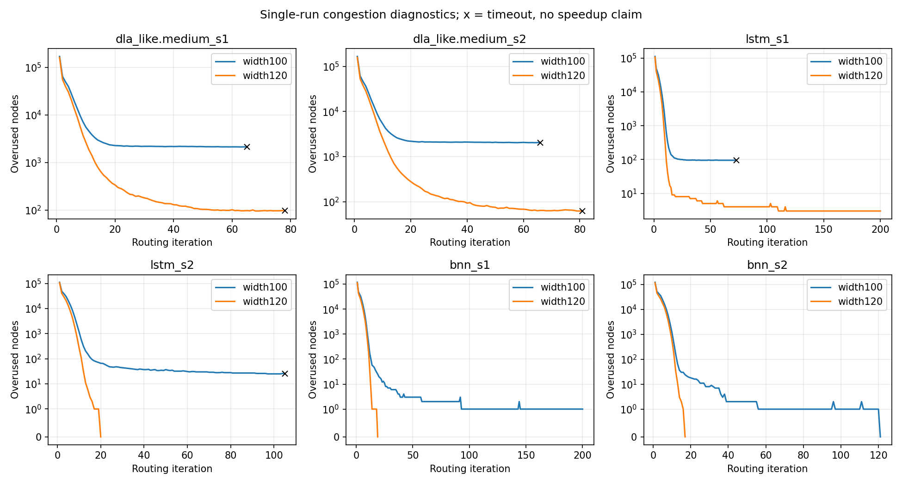

# 线宽120完整结果复核

六项全部完成，3项合法且独立FULL/STA通过；41份绑定产物和六份新RR图重新核验通过。

|布局|结果|最后完成轮数|最后观察过用|
|---|---|---:|---:|
|dla_like.medium_s1|timeout|78|97|
|dla_like.medium_s2|timeout|81|62|
|lstm_s1|failed|200|3|
|lstm_s2|合法|20|0|
|bnn_s1|合法|19|0|
|bnn_s2|合法|17|0|

DLA的两个值是超时前最后完整迭代，不是合法终点。LSTM_s1失败路径产生的CPD/线长不作有效质量指标。

扩宽后LSTM_s2与BNN_s1本次找到合法路由，BNN_s2保持合法；DLA两布局和LSTM_s1仍失败。不能只选三个成功布局计算泛化加速，也不能把单次结果当稳定可布通率。

LSTM_s1的三个过用节点3619305/3619470/3619539均为层0、x=73的CHANY，容量1/占用2。分别涉及DSP输入附近、同一DSP的两个输出、另一个DSP输入附近的竞争。该观察不证明垂直资源不足或图本身无解。

input_74_74_0：64个有效引脚，212个直接邻居，单位容量匹配64。
output_74_77_0：30个有效引脚，52个直接邻居，单位容量匹配30。
input_74_79_0：64个有效引脚，212个直接邻居，单位容量匹配64。

引脚匹配按块和输入/输出方向分别检查，未扣除其他网络占用，也未求多跳互不冲突路径；完整匹配仅排除这三个局部集合的直接邻居数量不足，不能证明全图可布通。

后续同图同缓存串行诊断已完成：200轮仍3过用，节点与并行不同，但同在层0 x=73 CHANY。见[串行诊断报告](../native_lstm_width120_serial_20261104/report.md)。不报告一核对八核速度比，不自动扩宽、延长超时或启动候选性能矩阵；原宽100失败及全部负例保持。

宽120进程生成/写图，宽100进程读图；本报告不比较进程时间。
